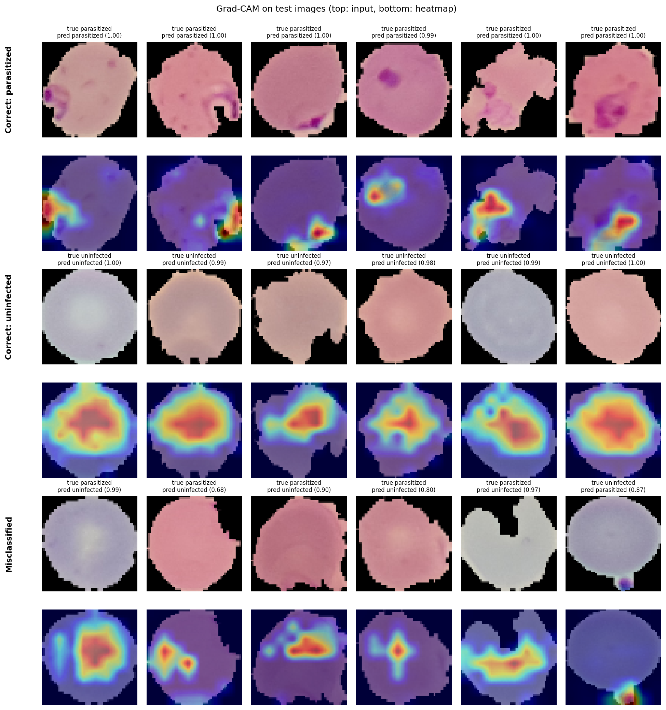

# Malaria Cell Classification with a Residual Network and Grad-CAM

Binary classification of thin blood smear cell images as **parasitized** or **uninfected**, trained and evaluated on the full NIH Malaria Cell Images dataset, with Grad-CAM to inspect which image regions drive each prediction.

**Test accuracy 96.3%, ROC AUC 0.990** on 2,756 held-out images.

## Credit

The network architecture and training setup follow Adrian Rosebrock's PyImageSearch tutorial, *Deep learning and medical image analysis with Keras* (2018). My first version (in `legacy/`) reproduced that pipeline on a 100-image subset. This version ports the code to TensorFlow 2, trains on the full dataset with a fixed train/validation/test split, evaluates on a held-out test set, and adds Grad-CAM interpretability and an error analysis.

## Run it

Open [`malaria_resnet_gradcam.ipynb`](malaria_resnet_gradcam.ipynb) in Google Colab, set the runtime to a GPU (Runtime → Change runtime type → T4 GPU), and choose Run all. The dataset downloads automatically through TensorFlow Datasets. Training takes about 20–40 minutes on a T4.

## Data

- **Dataset:** NIH Malaria Cell Images (27,558 segmented red blood cell images, roughly balanced), loaded with `tfds.load("malaria")`.
- **Split:** deterministic 80/10/10 into training (22,046), validation (2,756) and test (2,756). The test set is used once, at the end.
- **Preprocessing:** images resized to 64×64 and scaled to [0, 1]. The training set is augmented with rotation, zoom, translation and horizontal flips.

## Model and training

A bottleneck ResNet (stages (2, 2, 3), filters (32, 64, 128, 256), L2 regularisation), as in the tutorial, with two changes:

- global average pooling instead of a fixed 8×8 pool, so the model works at any input size;
- categorical cross-entropy, the correct loss for a two-class softmax output (the original used binary cross-entropy).

Trained for 25 epochs with SGD (momentum 0.9, learning rate 0.1 with cosine decay), batch size 32. The checkpoint with the best validation accuracy is used for testing.

## Results

| Metric | Value |
|---|---|
| Test accuracy | 96.3% |
| ROC AUC (parasitized) | 0.990 |
| Parasitized: recall / precision | 95.1% / 97.4% |
| Uninfected: recall / precision | 97.5% / 95.3% |

Confusion matrix on the test set (n = 2,756):

| | Predicted parasitized | Predicted uninfected |
|---|---|---|
| **True parasitized** | 1,304 | 67 |
| **True uninfected** | 35 | 1,350 |

Errors lean towards **missed infections** (67 false negatives against 35 false positives), which is the more costly error in diagnosis.

## Grad-CAM: what the model looks at



Grad-CAM (Selvaraju et al., 2017) highlights the regions of the final feature maps that most increase the predicted class score.

- **Correctly detected infections:** the heat falls on the stained parasite in each example, so the model is largely using the right evidence.
- **Correctly identified uninfected cells:** the maps are broad and cover the cell interior, consistent with the model checking the whole cell and finding no parasite.
- **Missed infections:** mostly pale, low-contrast cells where the parasite is faint.
- **False positive:** in the example shown, the model responds to a stained blob outside the cell boundary, which suggests it has partly learned "purple stain" rather than "parasite".
- **Possible label noise:** some cells labelled parasitized show no visible parasite, so part of the error may come from the labels rather than the model.

At 64×64 the final feature map is only 8×8, so the maps are coarse.

## Next steps

- Retrain at 128×128 for sharper Grad-CAM maps, and compare accuracy
- Review the misclassified images for label errors
- Test robustness to stain colour variation, for example with stain or colour augmentation

## Repository layout

```
malaria_resnet_gradcam.ipynb   training, evaluation and Grad-CAM (TensorFlow 2, Colab)
results/                       test metrics and figures
legacy/                        original Keras scripts (100-image subset)
```
