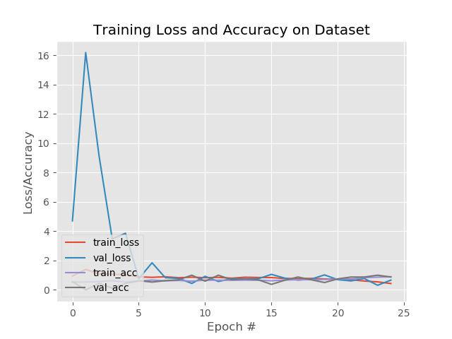

# Malaria Cell Classification with a Residual Network (Keras)

Binary classification of thin blood smear cell images as **Parasitized** or **Uninfected**, using a compact ResNet-style convolutional network in Keras. This was an early medical image analysis project, built while learning deep learning for computer vision.

## Credit

This implementation follows the approach and code structure of Adrian Rosebrock's PyImageSearch tutorial, *Deep learning and medical image analysis with Keras* (2018), including the ResNet architecture class and the training pipeline. My work was reproducing the pipeline, training on a reduced subset of the data, and adapting the scripts for saving and reloading the model.

## Dataset

- **Source:** the NIH Malaria Cell Images dataset (27,558 segmented cell images, balanced between parasitized and uninfected), from the U.S. National Library of Medicine.
- **Used here:** a subset of **100 images**, split into training, validation and testing folders.

Expected layout:

```
malaria/
├── training/
│   ├── Parasitized/
│   └── Uninfected/
├── validation/
│   ├── Parasitized/
│   └── Uninfected/
└── testing/
    ├── Parasitized/
    └── Uninfected/
```

The splitting script is not included in this repository; any split into this folder layout works.

## Model

`resnet.py` defines a small residual network with bottleneck residual modules (1×1 → 3×3 → 1×1 convolutions with batch normalisation, ReLU and L2 regularisation):

- Input: 64×64 RGB images
- Stages: (2, 2, 3) residual modules with filters (32, 64, 128, 256)
- Head: average pooling, then a softmax layer over the two classes

## Training

`save_model.py` trains and saves the network:

- Optimiser: SGD with momentum 0.9, initial learning rate 0.1 with decay
- 25 epochs, batch size 32
- Training-time augmentation: rotation, zoom, shift, shear and horizontal flip
- Prints a classification report on the test set, saves the model, and writes the loss and accuracy curves to `plot.png`

```bash
python save_model.py --dataset malaria --model saved_model.model
```

`load_model.py` reloads the trained model, classifies 16 random test images and shows them as a labelled montage:

```bash
python load_model.py --images malaria/testing --model saved_model.model
```

## Results

`plot.png` shows the training and validation curves for the 100-image run. With so little data, validation loss and accuracy are noisy from epoch to epoch, so this run should be read as a working pipeline rather than a reliable accuracy estimate. Training on the full dataset is needed for a meaningful test accuracy.



## Requirements

The code uses the standalone Keras 2.x API from around 2019 (for example `keras.layers.normalization`, `fit_generator` and the `lr` argument to `SGD`), so it needs an older environment, such as Python 3.6–3.7 with Keras 2.2 and TensorFlow 1.x. Other dependencies: scikit-learn, imutils, OpenCV, NumPy and Matplotlib.

`save_model.py` imports the model with `from myfiles.resnet import ResNet`. Either place `resnet.py` in a `myfiles/` package or change the import to `from resnet import ResNet`.

## Possible extensions

- Train and evaluate on the full dataset with a fixed, reported test split
- Update the code to TensorFlow 2 / Keras 3
- Add interpretability, for example Grad-CAM maps showing which image regions drive each prediction
